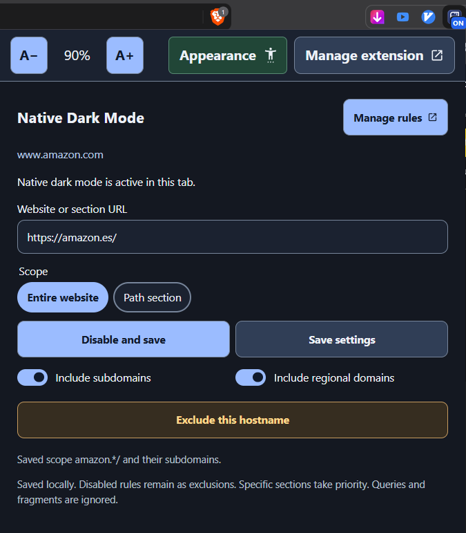
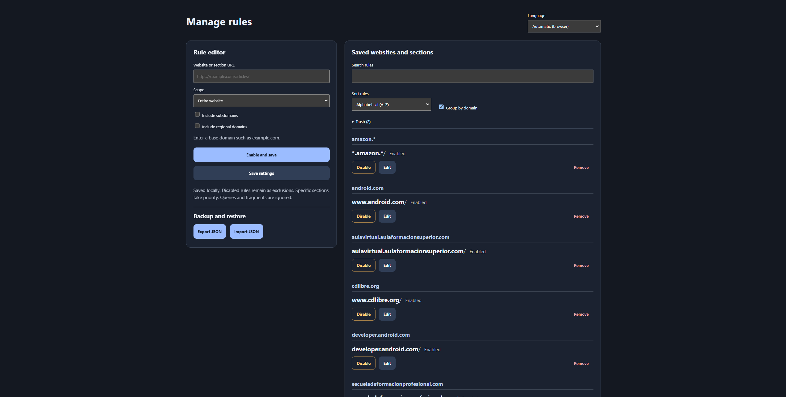

# Modo oscuro nativo para Chromium

[Read in English](README.md)

Usa el modo oscuro integrado en Chromium en las webs y secciones que elijas. Guarda una regla una vez y la extensión la aplicará cuando vuelvas.

La **versión 0.10.0** añade copias de seguridad completas con importación selectiva, mejora el contraste compartido de iconos e imágenes y corrige los niveles de borde y la representación durante el desplazamiento. [Notas de la versión en inglés](docs/RELEASE-0.10.0.md)

Este proyecto se desarrolló con la ayuda de IA mediante OpenAI Codex.

## Instalar la extensión

Solo necesitas un navegador de escritorio basado en Chromium. La extensión se ha probado en Brave. El navegador carga la extensión directamente desde la carpeta descargada, sin necesidad de instalar Node.js, npm o Python.

1. **Descarga y descomprime el proyecto.** En GitHub, pulsa **Code → Download ZIP**. Extrae el ZIP en una carpeta que puedas conservar.
2. **Abre la página de extensiones.** Escribe `brave://extensions` en Brave, `chrome://extensions` en Chrome o Chromium, o `edge://extensions` en Edge.
3. **Carga la carpeta correcta.** Activa **Modo de desarrollador**, pulsa **Cargar descomprimida** (**Load unpacked**) y selecciona la carpeta **`extension`** que hay dentro del proyecto. Es la carpeta que contiene `manifest.json`.
4. **Abre la extensión.** Busca **Modo oscuro nativo** en el menú de extensiones. Puedes fijarla en la barra del navegador.

Para actualizarla, reemplaza los archivos de la carpeta cargada con la nueva versión y pulsa **Recargar** en la ficha de la extensión. Recarga la web si quieres volver a probarla.

## Motivación

Muchas webs carecen de un tema oscuro. En otras hay que activarlo a mano o volver a elegirlo en cada visita. Las extensiones de modo oscuro pueden ayudar, pero su resultado varía de una web a otra. A veces aparecen textos difíciles de leer, contrastes pobres o colores inesperados.

Este proyecto usa el motor de oscurecimiento del propio navegador y recuerda dónde quieres aplicarlo. Puedes activarlo para una web entera y guardar excepciones para un subdominio o una sección concreta.

## Elegir el tema de la web

| Tema | Propósito |
| --- | --- |
| **Nativo** | Oscurecimiento del propio Chromium mediante una sesión de depuración. Sigue siendo el predeterminado; Chromium decide cómo se representan la página y sus imágenes. |
| **Nativo simulado** | Motor personalizado inspirado en Chromium, con correcciones adicionales de contraste y usabilidad. No necesita depuración ni el acceso directo para ocultar su aviso. |
| **Oscuro suave** | Paleta gris carbón con correcciones compartidas de contraste, iconos, textos sobre imágenes y bordes. |
| **Alto contraste** | Paleta más marcada, con texto y controles más luminosos y los mismos mecanismos compartidos de corrección. |

**Nativo simulado pretende mejorar el resultado, no ser una réplica exacta de Nativo.** La transformación de color de Chromium es el punto de partida. El motor también examina los fondos, la transparencia, los píxeles de las imágenes cuando puede leerlos, la estructura de los iconos y los estados de interacción para corregir problemas que Nativo puede dejar sin resolver. Busca conservar los colores útiles, las formas originales de los iconos, las imágenes y la distribución, mejorando la legibilidad. Las diferencias con Nativo son deliberadas cuando ayudan a esos objetivos; el nombre no promete una reproducción píxel a píxel ni un resultado mejor en todas las páginas.

La apariencia de las webs es independiente del tema claro/oscuro, el tamaño de texto y el alto contraste de la interfaz de la extensión. Si una página no se representa bien, prueba otro tema de web o crea una exclusión.

## Capturas

Haz clic en una captura para abrirla a resolución completa.

### Panel de la extensión

### Gestor de reglas

## Usar la extensión

1. Abre una web HTTP o HTTPS y pulsa el icono de la extensión.
2. Para una regla nueva, el popup usa tus **Valores predeterminados** (inicialmente **Web completa**) y muestra la dirección base del sitio. Elige **Sección por ruta** para usar la ruta de la pestaña actual sin parámetros de consulta ni fragmento. Puedes editar la URL antes de guardar.
3. En **Tema de la web**, elige **Nativo**, **Nativo simulado**, **Oscuro suave** o **Alto contraste** y pulsa **Activar y guardar**. La extensión recuerda tu elección para esa web o sección.
4. Pulsa **Desactivar y guardar** para guardar una exclusión, o abre **Gestionar reglas** para editar, buscar o eliminar reglas guardadas.

En tiendas de extensiones protegidas, páginas internas del navegador o de extensiones y visores PDF detectados, el popup muestra una advertencia que explica por qué no se puede aplicar el tema y desactiva los controles de la regla. Puedes seguir abriendo **Gestionar reglas**. No es posible detectar de antemano todos los visores integrados.

**Nativo simulado** suaviza los separadores decorativos claros de forma predeterminada. Usa **Resaltar separadores** para elegir Desactivado, Muy bajo, Bajo, Medio, Alto o Máximo. Los niveles superiores refuerzan los separadores, los bordes de tarjetas y los controles compactos de icono compatibles sin cambiar su tamaño. Desactivado no añade contornos opcionales, pero conserva los bordes normales del tema y sus correcciones de contraste. La regla comparte este nivel entre **Nativo simulado**, **Oscuro suave** y **Alto contraste** para la web o sección que cubre y lo incluye en las copias de seguridad.

En el gestor de reglas, abre **Valores predeterminados** para elegir el tema, el nivel de separadores, el alcance y las opciones de dominio de las reglas nuevas. Web completa y Ruta guardan sus opciones de dominio por separado. En Ruta también puedes elegir si se incluyen las subrutas. Las reglas guardadas conservan sus ajustes. Las opciones de dominio base y dominios regionales se aplican cuando la dirección las admite.

En un alcance existente, el tema, el nivel de separadores y los cambios de interruptores compatibles se guardan al instante. Editar la dirección o cambiar entre web y ruta sigue requiriendo guardar. **Guardar ajustes** guarda el alcance y el tema elegidos, y conserva el estado de la regla si ya existe. Una regla nueva guardada así queda desactivada. En el popup, si cambias una sección guardada a **Web completa** y guardas, la regla del sitio sustituye a la de esa sección.

El icono de papelera junto a **Guardar ajustes** muestra la regla guardada seleccionada para el nombre de host actual y pide confirmación antes de moverla a la **Papelera**. En una regla regional, el icono aparece en el host donde se guardó la regla, incluido su alias `www`. En los demás hosts cubiertos, el popup ofrece una exclusión local. Para las reglas heredadas, el icono queda deshabilitado y su ayuda indica que se pueden eliminar en **Gestionar reglas**.

**Nativo** es el tema predeterminado. **Oscuro suave** usa fondos gris carbón y **Alto contraste** resalta el texto, los bordes y los contornos de foco. **Nativo simulado** parte de una conversión de color inspirada en Chromium y añade correcciones según el contexto sin abrir una sesión de depuración. Los temas se aplican a la web y a los marcos en los que la extensión puede ejecutarse. El cambio de tema de una regla existente se guarda al instante. Para una regla nueva, elige el tema antes de pulsar **Activar y guardar**.

| Opción | Qué cubre |
| --- | --- |
| **Web completa** | El nombre de host indicado en el campo de URL. |
| **Sección por ruta** | Una ruta concreta, como `/articulos`. **Incluir subrutas** está activado por defecto y abarca también rutas como `/articulos/guia`. Desactívalo para que la regla se aplique solo a `/articulos`. |
| **Incluir subdominios** | Nombres como `developer.android.com`. El dominio base y su alias `www` comparten regla con independencia de esta opción. |
| **Incluir dominios regionales** | Varía el sufijo público y conserva el nombre registrado y el subdominio específico. Por ejemplo, `amazon.es` pasa a `amazon.*` y `fonts.google.com` a `fonts.google.*`. |
| **Aplicar a todo …** | Desde un subdominio como `fonts.google.com`, incluye el dominio base `google.com` y todos sus subdominios. Combínalo con los dominios regionales para abarcar la misma familia en otros sufijos públicos reconocidos. Si la página ya hereda una regla activa del dominio base, el popup muestra el interruptor marcado y bloqueado. Usa la acción de exclusión para exceptuar solo el subdominio actual. |

Las rutas más específicas tienen prioridad. Para la misma ruta, un dominio concreto tiene prioridad sobre una regla regional. Si la página hereda una regla activa, el panel puede ofrecer una exclusión para el nombre de host actual y la ruta heredada. Excluir `amazon.es` también excluye `www.amazon.es`.

Para excluir una ruta dentro de una web o sección activa, introduce la URL más específica, elige **Sección por ruta** y pulsa **Guardar ajustes** para crear una regla desactivada. Por ejemplo, una regla desactivada para `example.com/blog/privado` excluye esa ruta y sus subrutas de una regla activa para `example.com/blog`. Si ya hay una regla activa para esa ruta exacta, desactívala desde el listado.

**Gestionar reglas** abre la lista completa en otra pestaña. Puedes buscar y ordenar por nombre o fecha de añadido, en orden ascendente o descendente. **Agrupar por dominio** muestra grupos plegables con el botón **Expandir todos / Contraer todos**. La fecha aparece cuando está guardada en la regla.

**Eliminar** mueve la regla a la **Papelera**, después del listado de reglas guardadas. **Eliminar grupo** pide confirmación antes de mover todas las reglas de un grupo a la papelera, incluidas las ocultas por la búsqueda. Puedes recuperarlas con sus ajustes, usar **Eliminar definitivamente** en una entrada individual o elegir **Vaciar papelera**. El borrado definitivo pide confirmación. Si ya existe una regla para el mismo alcance, la copia eliminada se queda en la papelera al intentar restaurarla.

El gestor ofrece **Exportar configuración** e **Importar configuración**. Las copias incluyen las reglas guardadas, la papelera y los valores predeterminados. Al importar puedes elegir estos tres bloques de forma independiente. Solo las reglas aparecen seleccionadas inicialmente; la papelera y los valores predeterminados son opcionales. Las reglas conservan las opciones de añadir solo las nuevas, actualizar las coincidencias o reemplazar toda la lista. El reemplazo muestra las reglas actuales que eliminará y pide confirmación. La importación de la papelera añade las entradas que falten y conserva el historial existente; no las restaura como reglas activas. Los valores predeterminados solo se importan si los seleccionas y afectan a las reglas futuras, sin cambiar los ajustes de las existentes. Los bloques ausentes en copias antiguas quedan deshabilitados. Cancelar, la X, Escape o un clic fuera del diálogo cierran la importación sin cambios.

La apariencia, el tamaño del texto, el idioma y las preferencias de visualización de la lista siguen siendo locales y no se incluyen en la copia. Se validan todos los bloques del archivo antes de guardar juntos los seleccionados. El límite es de 1 MiB por archivo y de 1.000 entradas por lista de reglas o papelera.

La interfaz sigue el idioma del navegador por defecto. En **Idioma** puedes elegir español, inglés, francés, portugués europeo, italiano, chino simplificado, japonés, coreano o alemán.

Usa **A−** y **A+** en la parte superior para ajustar el texto del 75 % al 200 %. Cada vista guarda su propio tamaño de texto. En el panel, abre **Apariencia** para cambiar de tema o activar **Alto contraste**. En el gestor, esos controles están en la barra superior. Ambas vistas comparten el tema y el contraste. El tema sigue al sistema por defecto. El modo oscuro de las webs se controla por separado con las reglas.

Activa **Borde del popup** en **Apariencia** para distinguir mejor los límites del panel.

## Cómo funciona

La [extensión Manifest V3](extension/manifest.json) tiene un panel, un gestor de reglas y un [servicio en segundo plano](extension/background.js).

1. Cuando una pestaña se carga o cambia de URL, el servicio busca la regla aplicable en `chrome.storage.local`. Para los dominios regionales, usa una copia de la sección ICANN de la [Public Suffix List](https://publicsuffix.org/list/).
2. Si la regla nativa está activa, el [controlador](extension/controller.js) se conecta a la pestaña con `chrome.debugger` y ejecuta `Emulation.setAutoDarkModeOverride`. Chromium se encarga del renderizado y de las imágenes. Los temas personalizados usan un [script de contenido](extension/website-theme.js) que aplica estilos reversibles en cada marco compatible y funciona sin una sesión de depuración.
3. Si la regla deja de aplicarse o se desactiva, el controlador retira el modo oscuro y cierra la conexión. Si cancelas la depuración, la activación automática queda pausada en esa pestaña hasta que pulses **Activar y guardar**.

La extensión usa permisos de depuración para el modo nativo, acceso a sitios HTTP y HTTPS para evaluar las reglas y aplicar los temas personalizados, el permiso `scripting` para aplicar esos temas en pestañas que ya estaban abiertas y almacenamiento para guardar las reglas en el dispositivo. No hay telemetría ni un servicio de analítica. Los temas personalizados pueden leer imágenes y recursos SVG referenciados por la página para analizar su contraste. Las lecturas entre orígenes usan CORS sin credenciales; las del mismo origen pueden usar la sesión existente de la página. Las peticiones tienen límites y los resultados se guardan en caché. Los servidores de esos recursos pueden observar las peticiones. Cuando no se pueden leer o analizar, se conserva un comportamiento alternativo prudente.

Los temas personalizados comparten la planificación del trabajo, las mediciones de contraste, las correcciones de SVG e iconos de fondo, el análisis de textos sobre imágenes, los bordes opcionales y la limpieza de estilos. Pueden actuar sobre los Shadow DOM abiertos y los cerrados que expone la API de extensiones de Chromium; las raíces inaccesibles y los marcos protegidos quedan fuera de su control. Analizan superficies sólidas y translúcidas, degradados y SVG decorativos, sprites, máscaras, textos de ayuda y estados de interacción. Conservan las fotos, las imágenes multicolor y la geometría original de los iconos cuando pueden distinguirlos de forma fiable. Algunas imágenes estáticas transparentes o monocromas pueden recibir un fondo local o un tinte tras un análisis limitado; los recursos ambiguos o ilegibles se omiten.

La conversión de color de Nativo simulado se ha adaptado de Chromium bajo su licencia de tipo BSD. Las correcciones adicionales de contraste y representación son comportamiento de la extensión, no una reproducción completa del sistema de pintado de Blink. [Licencia de Chromium](extension/LICENSE.chromium) · [Guía de renderizado e inventario de correcciones, en inglés](docs/WEBSITE-THEME-RENDERING.md)

La extensión importa copias en las versiones 1, 2, 3 y 4. Las copias completas usan la versión 4; las versiones 1–3 contienen únicamente reglas. Se mantiene el identificador de formato `native-dark-mode-rules`. Las versiones anteriores de la extensión que no admiten el formato 4 no pueden importar una copia completa. Las copias con **Nativo simulado** o niveles de énfasis también requieren una versión de la extensión compatible con esos ajustes.

## Acceso directo opcional para ocultar el aviso de depuración

Puedes usar la extensión en cuanto esté cargada. Si el navegador muestra el aviso de depuración y quieres ocultarlo, ejecuta el instalador de tu sistema desde la carpeta del proyecto.

| Sistema | Instalador | Dónde aparece el acceso |
| --- | --- | --- |
| Windows | Haz doble clic en [install-launcher-windows.cmd](scripts/install-launcher-windows.cmd) y confirma la lista de accesos encontrados. | Tus accesos directos habituales. |
| Linux | Ejecuta `sh scripts/install-launcher-linux.sh`. | Menú de aplicaciones y escritorio, si está configurado. El entorno de escritorio puede pedirte que marques el acceso como de confianza. |
| macOS | Ejecuta `sh scripts/install-launcher-macos.command`. | Carpeta `~/Applications` y un enlace en el escritorio, si la carpeta existe. |

1. La consola muestra qué acceso actualiza o qué accesos crea y dónde. Pulsa **Enter** al terminar.
2. Cierra completamente el navegador y ábrelo desde el acceso que acabas de actualizar o crear.

El acceso añade `--silent-debugger-extension-api` al inicio. Si el navegador admite ese parámetro, se ocultan los avisos de todas las extensiones de depuración durante esa sesión. Puedes comprobar que recibió el argumento en la página de versión del navegador, en el campo **Línea de comandos**.

Los instaladores usan herramientas del sistema. En Windows, el instalador y el restaurador siguen el idioma de la interfaz de Windows y ofrecen los mismos nueve idiomas que la extensión. Los instaladores de Linux y macOS ofrecen español e inglés según el idioma de la consola, con la preferencia regional de macOS como alternativa. Si el idioma no está disponible o no tiene traducción, se usa el inglés. Puedes fijar el idioma con `NATIVE_DARK_MODE_LANG` y un código admitido. Si el navegador está en una ruta personalizada, puedes pasar `--browser "RUTA_ABSOLUTA_AL_EJECUTABLE"`.

En Windows, el instalador busca en el escritorio, el menú Inicio y los anclajes de la barra de tareas guardados como archivos `.lnk`. Muestra los accesos a navegadores reconocidos y pide confirmación. Omite los accesos a aplicaciones web y los que ya tienen el parámetro. Para cada actualización guarda una copia original `.lnk.bak` y conserva los argumentos existentes. Los accesos compartidos pueden requerir permisos adicionales en Windows.

Si Windows deniega la escritura, el instalador muestra los accesos pendientes y ofrece abrir una consola de administrador aparte. Si aceptas el aviso de permisos de Windows, esa consola te pide confirmar los cambios pendientes antes de escribir. Puedes cancelar en cualquiera de los avisos y conservar los cambios ya realizados con permisos normales.

Para deshacer los cambios, haz doble clic en [restore-launcher-windows.cmd](scripts/restore-launcher-windows.cmd) y confirma la lista. Busca en las mismas ubicaciones y restaura cada original que coincide con su copia `.lnk.bak`. Si Windows deniega la escritura, ofrece el mismo reintento como administrador. Para buscar copias fuera de las ubicaciones habituales, usa `--scan-directory "RUTA"`.

Desde la consola, usa `--scan-directory "RUTA"` para buscar en una carpeta y sus subcarpetas o `--update-shortcut "RUTA"` para seleccionar un único acceso. Combina cualquiera de las dos opciones con `--browser "RUTA_ABSOLUTA_AL_EJECUTABLE"` para exigir que coincida con ese ejecutable. Usa `--create-shortcuts` para crear accesos separados en el menú Inicio y el escritorio.

El acceso y la supresión del aviso se probaron en **Brave con Windows 11**. Linux y macOS tienen pruebas automatizadas de los archivos generados y siguen pendientes de probarse en esos sistemas. También queda por verificar la supresión del aviso en otros navegadores.

## Límites y desarrollo

**No es una solución perfecta.** Trabajamos para que funcione en el máximo de webs posible, pero cualquiera de los temas puede fallar en una página o estado concreto. Nativo depende de un comando experimental de Chromium; los temas personalizados deducen la intención de la página a partir de su estructura y sus estilos. Ninguno garantiza un contraste correcto en todos los casos. Una actualización de la web o del navegador puede cambiar el resultado.

- Los menús dinámicos, los gráficos anidados, las transiciones, el contenido fijo al hacer scroll y los fondos con imágenes complejas todavía pueden mostrar colores incorrectos, adaptación tardía o destellos. Algunos estados del panel de cuentas autenticadas de Google siguen bajo investigación; las correcciones locales de iconos no demuestran que todo el panel esté resuelto.
- Los objetivos de contraste son criterios de implementación, no una certificación de accesibilidad. El tamaño de los iconos, el suavizado, el grosor de las fuentes, la transparencia y la percepción influyen más allá de un único cociente.
- Las restricciones entre orígenes, las imágenes complejas o animadas, los Shadow DOM inaccesibles, los marcos protegidos, los visores PDF y las páginas internas limitan lo que los motores personalizados pueden analizar o cambiar. No se fuerza el recoloreado de recursos que no se pueden leer.
- La precarga y el procesamiento por lotes reducen el trabajo visible y mejoran la respuesta; las páginas muy grandes o que cambian constantemente pueden seguir siendo más lentas que Nativo.
- Brave en Windows concentra la mayor parte de las pruebas. Chrome, Edge, otras variantes de Chromium y Linux/macOS necesitan más comprobaciones completas.
- Chromium controla las imágenes de Nativo. Su opción de preservación por sitio sigue aplazada; consulta [IMAGE-RESEARCH.md](IMAGE-RESEARCH.md). Es independiente de las correcciones de imágenes de los temas personalizados.

Si una página falla, prueba otro tema, reduce el énfasis de bordes o guarda una exclusión. Para informar de un problema, incluye la URL, el tema, el nivel de borde, el navegador y su versión, la acción que lo provoca, una captura y el HTML/los estilos calculados relevantes, eliminando los datos personales.

La posible sustitución futura de Nativo, la revisión del nombre del producto y una web local de casos de regresión son planes, no cambios de esta versión. [Hoja de ruta, en inglés](docs/ROADMAP.md)

Las instrucciones de desarrollo, pruebas y versiones están en [AGENTS.md](AGENTS.md) y en el [README en inglés](README.md#development-and-screenshots). La extensión se carga directamente desde `extension/`, sin compilación.
