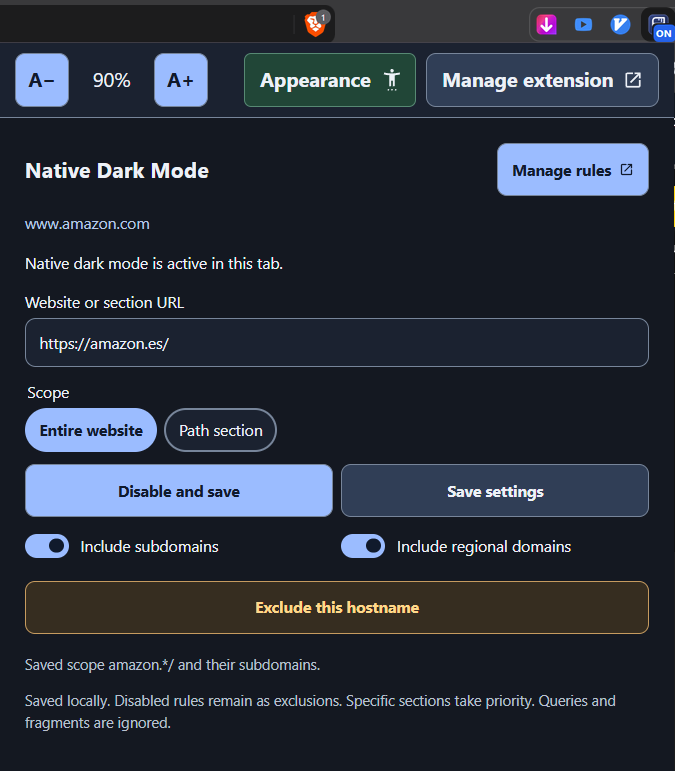
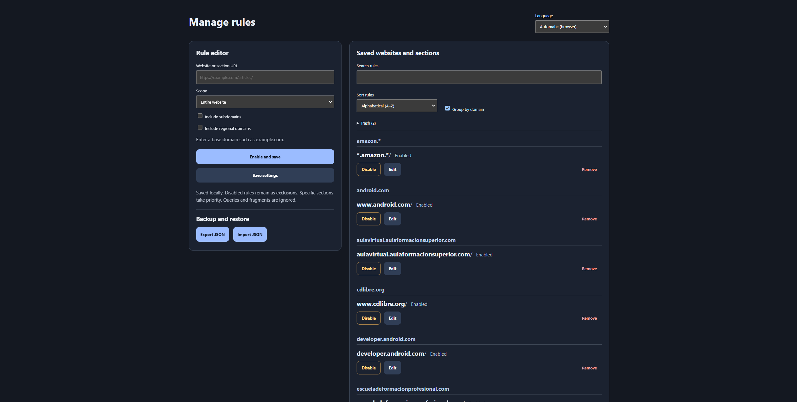

# Native Dark Mode for Chromium


[Read in Spanish](README.es.md)

Use Chromium's built-in dark mode on the websites and sections you choose. Save a rule once and the extension applies it when you return.

**Version 0.6.0** adds a DevTools-inspired icon, a more accessible interface, collapsible domain groups, and a preview and confirmation for replacement imports.

## Install the extension

You only need a desktop Chromium-based browser. Brave has been tested hands-on. The browser loads the extension directly from the downloaded folder. You can install it without Node.js, npm, Python, or a build step.

1. Download the project as a ZIP. On GitHub, choose **Code → Download ZIP**. Extract the ZIP to a folder you can keep.
2. In your browser's address bar, open `brave://extensions` (Brave), `chrome://extensions` (Chrome or Chromium), or `edge://extensions` (Edge).
3. Turn on **Developer mode**, click **Load unpacked**, and select the **`extension`** folder inside the extracted project. This is the folder that contains `manifest.json`.
4. Open **Native Dark Mode** from the browser's extensions menu. You can pin it to the toolbar.

To update, replace the files in the loaded folder with the new version and click **Reload** on the extension's card. Refresh any page you want to test again.

## Motivation

Many websites still have no dark theme. On others, dark mode starts off or the site forgets the preference between visits. General-purpose dark mode extensions can help, but in my experience their results vary from site to site. A page can look right in one extension and still have hard-to-read text, broken contrast, or unexpected colors in another.

This project started with a practical goal. Use the browser's own darkening engine where it renders a site well, then remember which sites and sections should use it. You can turn it on for an entire site and keep an exception for a particular hostname or section.

## Screenshots

Click either screenshot to open it at full resolution.

### Extension popup

<a href="docs/screenshots/popup.png"></a>

### Rule manager

<a href="docs/screenshots/rule-manager.png"></a>

## Use the extension

1. Visit an HTTP or HTTPS page and open the extension popup.
2. For a new rule, the popup starts with **Entire website** and shows the site's base address. Select **Path section** to use the current tab's path without its query string or fragment. You can edit the URL before saving.
3. Under **Website theme**, choose **Native**, **Soft dark**, or **High contrast**, then click **Enable and save**. The extension remembers your choice for that website or section.
4. Use **Disable and save** to keep a rule as an exclusion, or open **Manage rules** to edit, search, or remove saved rules.

**Save settings** saves the scope and theme without changing an existing rule's enabled state. A new rule saved this way starts disabled. In the popup, switching a saved section to **Entire website** and saving replaces that section with the website rule.

The trash icon beside **Save settings** shows the selected saved rule for the current host and asks for confirmation before moving it to **Trash**. Manage inherited and regional rules in the rule manager.

**Native** is the default for existing rules. **Soft dark** uses charcoal backgrounds, while **High contrast** emphasizes text, borders, and focus indicators. These themes affect the website and its eligible embedded frames. Changing the theme of a saved rule saves it immediately. For a new rule, choose the theme before clicking **Enable and save**.

| Option | What it covers |
| --- | --- |
| **Entire website** | The hostname in the URL field. |
| **Path section** | A specific path, such as `/articles`. **Include subpaths** is on by default and also covers paths such as `/articles/guide`. Turn it off to match only `/articles`. |
| **Include subdomains** | Child hostnames such as `developer.android.com`. The base domain and its `www` alias share a rule regardless of this option. |
| **Include regional domains** | Vary the public suffix while keeping the registered name and any specific subdomain. For example, `amazon.es` becomes `amazon.*`, and `fonts.google.com` becomes `fonts.google.*`. |
| **Apply to all of …** | From a subdomain such as `fonts.google.com`, include the base domain `google.com` and all its subdomains. Combine with regional domains to cover the same family across recognized public suffixes. When the current page already inherits an enabled base-domain rule, the popup shows this switch checked and disabled. Use the exclusion action to exempt just the current subdomain. |

More specific paths take priority. At the same path, a rule for a single domain takes priority over a regional pattern. Regional patterns match names across suffixes. When a page inherits an enabled rule, the popup can offer an exclusion for the current hostname and inherited path. Excluding `amazon.es` also excludes `www.amazon.es`.

To exclude a path from an enabled site or section, enter the more specific URL, choose **Path section**, and use **Save settings** to create a disabled rule. For example, a disabled rule for `example.com/blog/private` excludes that path and its descendants from an enabled rule for `example.com/blog`. If a rule for the exact path is already enabled, disable it from the list.

**Manage rules** opens a full tab where you can search and sort by name or date added, in either direction. **Group by domain** shows collapsible groups with an **Expand all / Collapse all** button. Dates are shown for rules with a saved creation date.

**Remove** moves a rule to **Trash**, after the saved rules list. In a domain group, **Remove group** asks for confirmation before moving all its rules to Trash, including rules hidden by search. You can restore a rule with its settings or choose **Empty trash** and confirm permanent deletion. If a saved rule already occupies the same scope, the deleted copy stays in Trash when you try to restore it.

The manager also offers **Export rule settings** and **Import rule settings**. The import dialog previews new and matching rules. By default it adds only new rules. You can also update matching rules or replace the entire list. The replacement option shows a scrollable list of the current rules it will delete and asks for confirmation. The JSON covers the main rule list. Trash and display preferences stay in local storage.

The interface follows the browser language by default. The **Language** selector in the manager lets you choose English, Spanish, French, European Portuguese, Italian, Simplified Chinese, Japanese, Korean, or German.

The language selector uses bundled SVGs from [flag-icons](https://github.com/lipis/flag-icons), distributed under the [MIT license](extension/flags/LICENSE).

Use the text size controls at the top left of the popup or rule manager to adjust text from 75% to 200%. Each view saves its own text size. Open **Appearance** in the popup or use the controls directly in the rule manager toolbar to enable high contrast or choose a light or dark theme. Both views share the theme and contrast preferences. The theme follows your system by default. Website dark mode is controlled separately by your rules.

## How it works

The [Manifest V3 extension](extension/manifest.json) has a popup, a full-page rule manager, and a [background service worker](extension/background.js). It requires the [extension debugger API](https://developer.chrome.com/docs/extensions/reference/api/debugger) and Chromium's experimental [native darkening command](https://chromedevtools.github.io/devtools-protocol/tot/Emulation/#method-setAutoDarkModeOverride).

1. The worker checks the current URL against the rules saved in `chrome.storage.local` when tabs load or navigate. The rule matcher handles hosts, paths, subdomains, exclusions, and regional patterns. Regional matching uses a bundled snapshot of the ICANN section of the [Public Suffix List](https://publicsuffix.org/list/).
2. For an enabled native rule, the [controller](extension/controller.js) attaches through `chrome.debugger` and sends `Emulation.setAutoDarkModeOverride` with `enabled: true`. Chromium handles rendering and images. The custom themes use a [content script](extension/website-theme.js) that applies reversible style overrides in each eligible frame and requires no debugger session.
3. When a rule stops matching or is disabled, the controller clears its override and releases the connection. If the user cancels the debugging session, automatic activation pauses for that tab. Use **Enable and save** to resume it.

The extension uses `debugger` for native emulation, HTTP and HTTPS site access to match URLs and apply custom themes, `scripting` to apply custom themes in tabs that were already open, and `storage` to keep rules on the device. The extension makes no external network requests.

Custom themes preserve image, video, and canvas pixels and leave image-backed backgrounds in place. They darken light CSS gradients that contain no images and theme shadow roots that Chromium exposes to extensions. Text over photos and frames where the browser blocks injection can retain the site's original appearance. Rules with custom themes export as JSON version 2. The extension can still import version 1.

## Optional launcher for the debugging banner

You can use the extension as soon as it is loaded. If the browser shows a debugging banner and you want to hide it, use the optional launcher below. It passes `--silent-debugger-extension-api`, which suppresses banners for **all** debugger extensions in that session when the browser supports it. Closing the banner or opening DevTools can disconnect the session.

Run the installer for your system from the project folder. The three installers are at the top level of `scripts/`, and their helpers stay in `scripts/internal/`. Each installer looks for Brave, Google Chrome, Chromium, Microsoft Edge, Vivaldi, and Opera in the usual locations for that platform. It creates one set of shortcuts per browser it finds, using the name **Browser Name - Native Dark Mode**.

| Platform | Installer | Where to open the launcher |
| --- | --- | --- |
| Windows | Double-click [install-launcher-windows.cmd](scripts/install-launcher-windows.cmd) | Start menu and your Desktop. |
| Linux | `sh scripts/install-launcher-linux.sh` | Your application menu and, when available, your configured desktop directory. Your desktop environment may require you to mark the desktop copy as trusted before opening it. |
| macOS | `sh scripts/install-launcher-macos.command` | Your `~/Applications` folder and a link on your Desktop, when the Desktop folder exists. |

The console explains what the installer is about to do and prints the path of each shortcut it creates. On Windows, the report groups shortcuts by browser and uses color in Windows Terminal. When you run the installer interactively, press Enter at the end to dismiss the prompt.

Installer messages are available in English and Spanish. The installer reads your Windows regional format or your shell locale on Linux and macOS, with the macOS regional preference as a fallback. Other languages use English. Set `NATIVE_DARK_MODE_LANG` to `en` or `es` to override the detected locale.

For a browser in a custom location or outside the detection list, append `--browser "ABSOLUTE_PATH_TO_BROWSER_EXECUTABLE"` to the installer command. This selects just that executable and uses the name **Chromium Browser - Native Dark Mode**. With `--output-directory PATH`, the installer writes only to that directory, which is useful for testing or keeping shortcuts for multiple custom executables separate.

Fully quit the target browser before opening the new launcher so the flag takes effect. Check **Command Line** on your browser's version page (for example, `chrome://version`, `edge://version`, or `brave://version`) for `--silent-debugger-extension-api`. The installers use tools included with the operating system. Windows uses Windows Script Host to create a `.lnk`. Linux and macOS use shell scripts.

The installer was tested on Windows 11, where banner suppression was confirmed in Brave. The Linux and macOS installers have automated checks for generated files, but have yet to be tested on actual Linux or macOS systems. Banner suppression in other browsers still needs hands-on verification.

## Current limits

- The extension uses an experimental Chromium DevTools Protocol command. Rendering can vary by site and browser version.
- Chrome, Edge, and other Chromium builds still need end-to-end verification.
- Rules apply to HTTP and HTTPS websites. Internal browser pages are outside the rule scope.
- Chromium controls image treatment. Per-site image preservation is deferred. See [IMAGE-RESEARCH.md](IMAGE-RESEARCH.md) for the experimental launch-time option and its limits.

## Development and screenshots

See [AGENTS.md](AGENTS.md) for the repository map, behavior to preserve, and release workflow.

Maintenance tools for the public suffix list and image research live in `scripts/dev/`.

Run `npm run check` and `npm test` with Node.js. The extension runs directly from `extension/` with no build step. For launcher tests, run `python -m unittest discover -s test -p 'test_*.py' -v`. The launcher tests use temporary files and a mock browser where appropriate. See [PLAN.md](PLAN.md) for validation notes.

For a repeatable screenshot or visual check, serve the local fixture and open it in the Chromium-based browser you are testing. Enable a rule for that page, then capture the popup or the rule manager. Suggested screenshot files are `docs/screenshots/popup.png` and `docs/screenshots/rule-manager.png`. Use sample rules and a public or local test page so screenshots can be shared without exposing personal tabs or browsing history.

```sh
python -m http.server 8765 --bind 127.0.0.1 --directory fixtures
```

Open `http://127.0.0.1:8765/test.html` to use the fixture.
