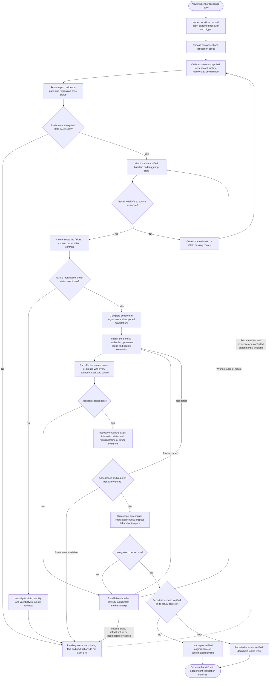

# Incident response decision flow

Operational entry point for new reports. Use this with [the repair procedure and current capability table](RENDERING-REPAIR-WORKFLOW.md), [reporting commands](REPORTING-AND-FAST-TESTING.md), [renderer policy](WEBSITE-THEME-RENDERING.md) and [reliability design](DIAGNOSTIC-RELIABILITY-DESIGN.md). This is a contributor workflow, not an implemented automatic incident manager.

## Decision flow



## Component routing

| Report category | Start here | Relevant checks and boundary |
| --- | --- | --- |
| Website paint, glyphs, borders, surfaces or image text | Source/computed paint, actual backing, ancestors/generated layers, resource delivery and crop, opacity, geometry and state | Match the source baseline before interpreting the themed reduction. Test all affected custom themes, Off/stronger levels, resampling, interactions and preservation negatives. Production fixes remain site-independent. |
| Flicker, startup, handoff, scrolling or responsiveness | Exact action sequence and cold/warm conditions; intermediate frames or paired timing evidence | A settled PNG cannot pass a temporal report. Separate website load from extension cost. Fresh-browser repetitions do not reproduce retained-profile or full-suite prerequisite state. General frame archival and complete live profiling remain pending. |
| Popup or manager interface | Both views, control semantics, focus, appearance and text size | Check normal/large text, keyboard, light/dark/high contrast, reduced motion and translated extension strings. A website paint fixture does not verify extension UI behavior. |
| Rules, exclusions, backups or defaults | Minimal input/state and expected matching, validation or queued write behavior | Use deterministic tests and relevant browser workflows. Preserve rule precedence, serialized writes, import validation and destructive-action safeguards. Website fixture registration is required only if a new rendering mechanism is involved. |
| Native debugger rendering or controller lifecycle | Winning rule, attachment/suspension state, handoff and CDP response | Preserve default Native behavior, clearing before detach and user-controlled resumption. The custom-theme gallery does not establish Native or desktop reload acceptance. |
| Launcher or installation | Platform/browser discovery, generated artifact and reported action | Use launcher tests and only claim actual desktop integration when checked. Preserve dependency-free unpacked installation. |

## Gate rules

**Scope and facts.** Inspect `git status --short --branch` and preserve existing edits. Record URL or registered case, component, expected/actual result, preset, separator level, trigger, browser/OS, viewport, DPR and zoom where relevant. Separate observations from inferred causes. Unknown settings remain unknown. An observed old callback error does not establish which renderer owns current paint.

**Evidence collection.** Prefer accessible public/local CDP evidence. Batch known independent facts per page/state. Use the source-aware review queue to prioritize findings, then inspect the selector-scoped bundle. An owned profile has no access to the reporter's login or open state. Do not collect input values or enable live labels/screenshots by assumption. If a personal-browser action is unavailable or control is stopped, use isolated evidence or name the exact user action needed; do not silently switch context and claim equivalence.

**Retention before repair.** Every unusual reported rendering mechanism needs a minimal checked-in fixture or an explicit pending evidence record, case registration in `tools/diagnostics/cases.mjs`, coverage in `tools/diagnostics/coverage.json` and the rendering-guide inventory. Missing source material is a gap, not permission to invent a faithful reproduction. Keep original public-asset provenance/checksums and separate synthetic tooling probes from reported-site cases. Retain a fixed case after repair.

**Source fidelity.** Compare unmodified local paint against supplied/public source evidence under matched conditions. Preserve inheritance/currentColor, source image/SVG/background/mask/content delivery, visible crop, ancestors, pseudo-elements, clipping, alpha, fonts, dimensions and control state. Do this manually with the current tooling; automatic contextual extraction is still planned. If the reduction differs, correct it before changing renderer heuristics. If missing evidence prevents correction, leave the report pending and retain the known facts.

**Reproduction and variability.** Demonstrate the reported failure and a contrasting control before repairing production behavior. If an issue already has a verified regression, reuse it rather than duplicating it. If the failure does not reproduce, inspect identity/settings/state and run a bounded experiment where supported; do not repeatedly request unchanged facts or retry until one pass appears. Record what the experiment distinguishes and what evidence would reopen the report. A distinct newly found mechanism must be retained separately from the original report.

**Repair.** Fix semantic/layout/computed-paint or component logic, preserving source geometry, useful colors, status/disabled behavior and reversible cleanup. Keep site/framework names/selectors in fixtures/research rather than production theme rules. Do not increase stroke/font weight or add text outlines as a blanket repair. Performance work needs a measured dominant cost and paired equivalent workloads. Do not reinterpret Native rules or rename presets incidentally.

**Verification and review.** Named cases retain their registered companions and all original variants; they do not infer every affected dependency. Shared classification/scheduling changes need broader selection. A failed bundle's expected/actual facts precede its later screenshot observation. Thresholds and changed-pixel counts prioritize review; they do not prove a defect or acceptable appearance. Match metadata before pixel interpretation; do not overwrite a reference to make a candidate look accepted. For temporal/performance incidents, require corresponding frame/timing evidence or retain that verification gap.

**Integration.** Follow the repository's checks for the changed scope. `npm.cmd run verify` runs syntax/Node/launcher checks; browser behavior also needs relevant browser verification. Use complete `npm.cmd run verify -- --browser` at the required integration/release boundary. Named or repeated cases do not replace that path. Read failures and inspect the diff; run `git diff --check`. Documentation-only changes do not require another browser matrix. Commit/version/tag/push only within the authorized scope.

## Runtime identity and repetition decisions

| Observed result | Required next step |
| --- | --- |
| Identity `match` | Check observed preset/level and state as well; matching code alone does not prove matching conditions or acceptable paint. |
| Identity `mismatch` | Retain the initialized/current dependency differences. Establish the intended code/context before attributing a renderer regression; remeasure any deliberately refreshed document separately. |
| Identity `unknown` or `unavailable` | State the gap. Do not infer stale code, a valid current instance or successful recovery. Querying must not reinject/recover merely to obtain a match. |
| Repetitions `passed` | All requested compatible attempts passed under the documented fresh-browser policy. This does not prove the original full-suite/personal state was reproduced. |
| Repetitions `failed` | Inspect the retained failures; this is not automatically proof of a renderer defect. |
| Repetitions `unstable` | Retain every failure and pass. Investigate the varying facts/state; a final pass does not close the report. |
| Repetitions `incomplete` | Inspect budget, timeout, infrastructure, source/scope/isolation and cleanup gaps. Restore comparable, observable conditions before drawing a product conclusion. |

Current repeats create a new Node/browser/profile/server per attempt. Retained-profile/document and original-prerequisite-prefix experiments remain unimplemented. If that distinction matters to the report, keep it explicit instead of using a fresh-profile pass as a substitute.

## Commands at the decision points

```powershell
# Facts for a public/default state; not an authenticated-tab or HTML/CSS exporter
npm.cmd run diagnose -- --issue --url "https://example.org/page" --selector ".affected-control"

# Discover actual registered IDs, companions and coverage
npm.cmd run verify -- --list-cases
npm.cmd run verify -- --cases select-proxy-and-field-frames
npm.cmd run verify -- --focus icons,borders

# Only when a fresh-browser repetition experiment answers a stated question
npm.cmd run verify -- --cases select-proxy-and-field-frames --repeat 3 --attempt-timeout 120 --repeat-timeout 600

# Local image review and timing evidence
npm.cmd run lab
npm.cmd run visuals -- list subtle-frame
npm.cmd run metrics

# Complete integration/release path and patch review
npm.cmd run verify -- --browser
git diff --check
```

`diagnose --issue` is a default-state bounded measurement bundle. Hover/scroll/authenticated states, inaccessible frames/roots/resources and unsupported pixels remain explicit gaps. The image viewer supports bounded static RGB/RGBA PNGs; it does not import live/supplied screenshots, generate frame sequences or certify source fidelity. Do not call planned tools as if they were available.

## Required handoff

Use this compact record when stopping, resuming or closing an incident. Store portable evidence/regressions in Git and transient logs/captures under ignored `research-artifacts/`; do not paste private source/account content.

```text
Incident / component:
Reported scenario and expected behavior:
Environment, preset, level and trigger:
Observed facts / inferred cause / remaining unknowns:
Source evidence verified: yes / no / partial / not applicable, with evidence
Failure reproduced: yes / no / partial, with fixture/state and preservation control
Local repair verified: yes / no / partial, with commands/results and image/frame evidence
Required integration verified: yes / no / partial, with exact scope
Original-context confirmation: yes / no / pending / not applicable, with provenance
Retained regression, coverage and guide entries:
Next action and the evidence that would resolve the remaining gap:
```

Pending describes the incident evidence/status, not an instruction to halt unrelated authorized work. Continue useful independent investigation; ask the reporter only for information or actions that available tools cannot supply. Do not repeatedly ask for already supplied facts.

These statuses are independent. A passing fixture does not become live confirmation, a missing screenshot does not become a visual pass, and unavailable evidence must not be reported as a resolved incident. A pending status can coexist with a useful verified local repair. Reopen for changed facts or a new failure; keep earlier raw evidence and accepted/rejected context intact.
